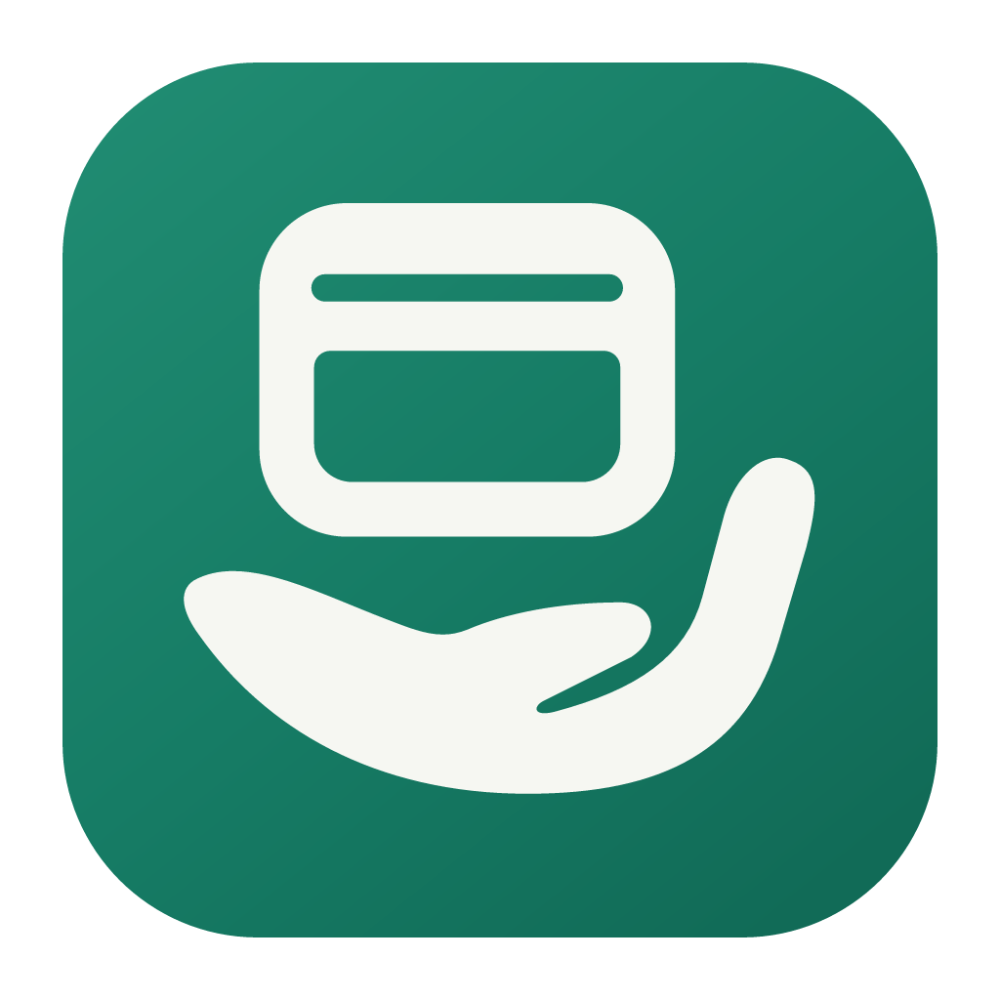

# Tenori · 过目



Tenori (手乗り) describes a small pet perched on a hand. The Chinese name 过目
comes from 请您过目 ("for your review"). The tagline is “Your desktop AI agents,
perched on your palm.” The existing window-in-a-palm artwork expresses “desktop
work, in your hand”; this rename does not redesign it. The open palm is one
continuous silhouette, with a curved cut between the fingers and thumb. The
window has a rounded frame, a quiet title bar, and an open working area.

The palette is forest green `#167C65`, charcoal green `#213D31` for adjacent
text, and warm ivory `#F6F7F2`. The desktop tile adds a subtle green gradient;
the navigation mark and browser tile use flat colors. Do not add AI sparkles,
connection arrows, or extra details inside the window.

## Source and exports

Edit **[build/source/tenori-mark.svg](../build/source/tenori-mark.svg)**,
then run:

```sh
pnpm install --frozen-lockfile
pnpm gen-icons
```

The generator renders each PNG directly from the vector, then assembles ICO
and ICNS files from those images. It runs on macOS, Windows, and Linux without
requiring platform image tools. Commit the generated files with source changes.

| Asset                                      | Use                                                                 |
| ------------------------------------------ | ------------------------------------------------------------------- |
| `src/assets/img/tenori-mark.svg`         | Single-color mark in the desktop sidebar and mobile header          |
| `build/source/tenori.svg`                | Application tile, with a transparent outer margin                   |
| `build/source/tenori.png`                | 1024px application artwork                                          |
| `build/icons/*x*.png`                      | Application images at 16, 24, 32, 48, 64, 128, 256, 512, and 1024px |
| `build/icons/icon.icns`                    | macOS application icon                                              |
| `build/icons/icon.ico`                     | Windows application icon, including 16–256px frames                 |
| `public/favicon.svg`, `public/favicon.ico` | Browser tile, with less outer padding for small tab icons           |

Generated assets should not be edited separately. The tile colors, padding,
and export sizes live in [scripts/generate-icons.mjs](../scripts/generate-icons.mjs).
Check the mark on light and dark backgrounds and the 16–48px exports when
changing its geometry. Preserve the space between the window and the palm.
